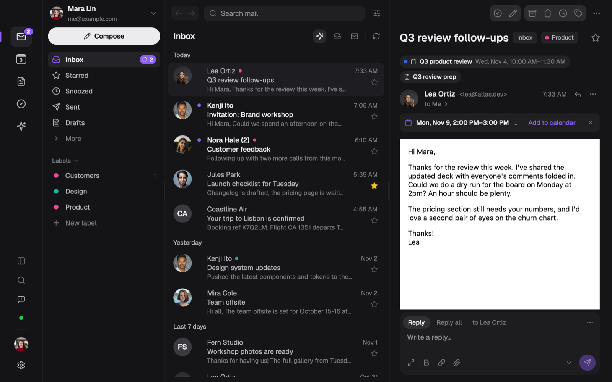
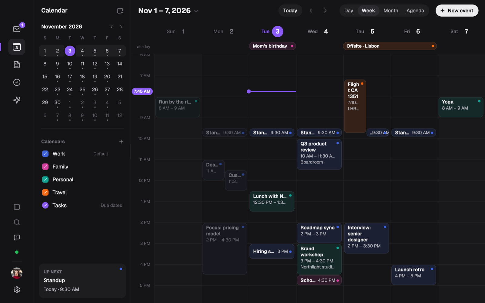

# Jefi Mail

A fast, native mail app for macOS, with calendar, notes and tasks beside your inbox. Free and open
source under the GPL.



Jefi is written in TypeScript and React, and draws its UI with [GPUIX](https://github.com/remorses/gpuix)
(React on Zed's GPU-accelerated GPUI) on [Bun](https://bun.sh). Mail is synced over IMAP and sent over
SMTP straight from your Mac. No Jefi server ever sees it.

- **Mail**: works with any IMAP provider, and Microsoft accounts sign in through the browser. Includes All Inboxes, a Screener for
  new senders, rules, snooze, send later, labels, and sign-in codes you copy in one click.
- **Privacy**: remote images stay hidden until you allow them, and tracking pixels never load. Links
  are checked before they open.
- **Calendar, notes and tasks**: linked to the conversations they came from.
- **AI (optional)**: summaries, translation and a mail assistant, using your own Anthropic or OpenAI
  key.
- **Secrets**: account passwords and API keys sit in one encrypted vault. Its key is the only thing
  kept in the macOS Keychain, so you get one Keychain prompt, not one per account.



Download the signed, notarized app at [jefi.app](https://jefi.app), or build it yourself.

## Building from source

You need a Mac with Apple silicon, [Bun](https://bun.sh) 1.4+, [Rust](https://rustup.rs) and Xcode
(or its command-line tools, `xcode-select --install`). The finished app runs on macOS 13 or later.

```bash
bun install
bun run dev        # builds the patched GPUIX addon once (a few minutes), then opens "Jefi Dev" with hot reload
```

### Signing in

Most providers, Gmail and iCloud included, sign in with an app password. Microsoft accounts sign in
through the browser (OAuth with PKCE). The build ships with Jefi's public Microsoft client id; to use
your own Entra app registration (a public client with a `http://localhost` redirect and the
delegated `IMAP.AccessAsUser.All`, `SMTP.Send` and `offline_access` permissions), set
`JEFI_MS_CLIENT_ID` in `.env`. Bun loads that file automatically; see `.env.example`.

### Checks

```bash
bun run typecheck
bun test ./src ./scripts
bun run screenshot   # launches the app off-screen and writes tmp/jefi-*.png
```

### A signed app of your own

`bun run bundle` builds `Jefi.app` and `bun run sign` signs and notarizes it. Signing reads
everything from the environment: `JEFI_SIGN_IDENTITY` (a "Developer ID Application" identity), and
either `JEFI_NOTARY_PROFILE` or `APPLE_ID`, `APPLE_TEAM_ID` and `APPLE_APP_SPECIFIC_PASSWORD`.
`scripts/release/setup-signing.sh` walks you through it.

Builds you make yourself never look for updates. The updater only runs in official releases, so a
release can never replace your build.

### Official releases

Releases are built by `.github/workflows/release.yml` from a `v*` tag, on a fresh GitHub-hosted Mac.
The signing and notarization keys live in a protected `release` environment: only a maintainer can
create release tags, and every run waits for their approval before it can read a key
(`scripts/release/protect-repo.sh` sets this up). Each DMG gets a build attestation, so you can
check that a download was built here, from a public commit:

```bash
gh attestation verify Jefi-0.9.0.dmg -R algolab-cloud/jefi-mail-oss
```

## Project layout

| Path | What's there |
| --- | --- |
| `src/mail.tsx` | The app: window, sidebar, list, reader and composer |
| `src/engine/` | The sync engine (IMAP, SMTP, OAuth, SQLite store), run in a worker |
| `src/calendar/`, `src/notes/`, `src/tasks/` | Calendar, notes and tasks |
| `src/menubar/` | The menu bar panel |
| `src/native/` | macOS bridges (Objective-C through Bun FFI): notifications, WKWebView, Keychain |
| `scripts/` | Dev runner, bundling, signing, screenshots, branding |
| `integrations/raycast/` | The Raycast extension |
| `docs/` | Architecture notes |

## Contributing

Issues and pull requests are welcome. See [CONTRIBUTING.md](CONTRIBUTING.md).

## Licence

Jefi Mail is free software: you can redistribute it and/or modify it under the terms of the GNU
General Public License as published by the Free Software Foundation, either version 3 of the
License, or (at your option) any later version. See [LICENSE](LICENSE).

Third-party components and their licences are listed in [THIRD_PARTY_NOTICES.md](THIRD_PARTY_NOTICES.md).

"Jefi" and the Jefi icon are trademarks of their owner and are not covered by the GPL. If you
publish a modified build, give it another name, icon and bundle identifier (`app.jefi.mail` is
Jefi's).
